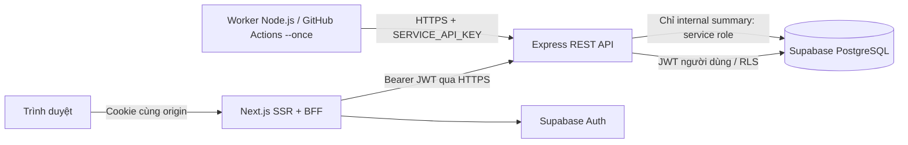

# Kiến trúc

## Ranh giới trách nhiệm

- `frontend`: Next.js App Router + TypeScript + Tailwind. Supabase SSR lưu/refresh phiên bằng cookie. Browser gọi BFF cùng origin; BFF chuyển JWT tới Express, không đưa service-role hoặc service API key ra client. `API_INTERNAL_URL` chỉ server, không phải biến `NEXT_PUBLIC_`.
- `backend`: Express + Zod + Helmet/CORS, validation và lỗi tập trung. `getUser` xác minh JWT; Supabase client từng request mang JWT đó và chịu RLS. Không dùng service role để xử lý CRUD người dùng.
- Database là nguồn chuẩn cho ngày nghiệp vụ, ownership, uniqueness, lịch sử trạng thái và quy tắc không chỉnh quá khứ. Constraint/trigger bảo vệ ngay cả khi bỏ qua Express và gọi Supabase REST.
- `worker`: Node.js 22 fetch tích hợp, không SDK database hay Redis. Immediate run khi khởi động, sau khi hoàn tất nghỉ một giờ rồi chạy lượt kế tiếp; `--once` chạy một lượt đầy đủ các trang rồi thoát. Không chạy chồng trong một process.

## Dữ liệu và nghiệp vụ

Múi giờ chọn một lần trong `profiles`. `habit_activity_days` lưu mốc trạng thái theo ngày; trạng thái tại ngày D lấy mốc gần nhất không sau D. Trigger chỉ cho thay đổi mốc hôm nay, cùng ngày upsert lấy trạng thái cuối. `habit_checkins` lưu DATE nghiệp vụ, không suy lại từ UTC.

Dashboard lấy summary hôm nay và dữ liệu bảy ngày trực tiếp bằng RPC được giới hạn người dùng. Streak tính từ chuỗi check-in chuẩn, không cache thành biến đếm dễ sai khi undo. `daily_summaries` là bản tổng hợp eventual, không quyết định check-in hoặc streak.

## Background và lỗi

Worker gửi từng batch tối đa 100 tới `POST /api/v1/internal/daily-summary/run`, theo cursor server. Backend chọn ngày đã kết thúc riêng cho từng timezone, làm bù mọi ngày thiếu và refresh bảy ngày đóng gần nhất. Unique `(user_id, summary_date)` cho phép upsert và chạy lại an toàn. Cursor bao gồm user và ngày để xử lý dữ liệu theo thứ tự ổn định; mỗi lượt mới bắt đầu không có cursor.

Timeout mỗi HTTP attempt 120 giây để chịu cold start. Tối đa ba attempt cho lỗi mạng, timeout, HTTP 408/429/5xx; exponential delay có jitter. 401/4xx và response sai contract không retry. Worker từ chối cursor lặp và báo lỗi thay vì vòng lặp vô hạn. SIGTERM/SIGINT hủy request đang chạy hoặc timer. Log chỉ event, số xử lý, thời gian và status; không log header, body, token, khóa hay lỗi transport thô.

## Môi trường

Local: Compose có frontend:3000, backend:5000, worker; Supabase từ xa. URL nội bộ Docker dùng `backend`; browser dùng localhost và BFF. Production: Vercel frontend, Render Free Web Service backend, Supabase và GitHub Actions worker. Không có Render Background Worker trả phí.

Render có thể sleep; Actions có thể bị trễ. Một job thất bại không làm mất check-in; lượt sau chạy lại và làm bù. Không dùng request tự ping để giữ service thức. HTTPS bắt buộc cho backend URL production; secret cấu hình riêng theo dịch vụ. Không hứa service miễn phí có SLA hay chạy đúng phút.
